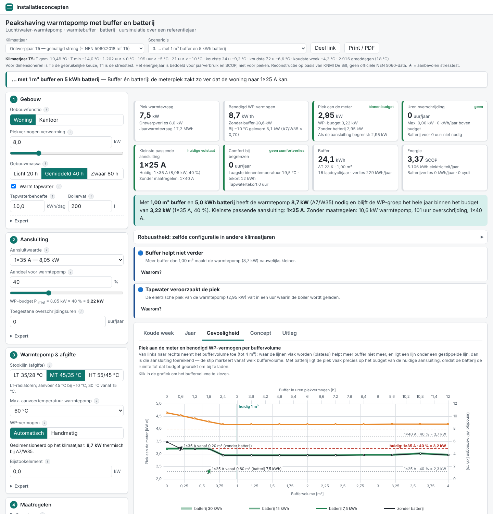

# Installatieconcepten

Interactieve rekenmodellen en visualisaties van installatieconcepten. Er zijn twee concepten:

1. **Klimaatplafond met 6-weg-klep** in een open kantoor: metalen plafondpanelen met koperen meanderactivering,
   aangesloten op één tot drie 6-weg-kleppen in een 4-pijpssysteem (`#/klimaatplafond`).
2. **Peakshaving warmtepomp met buffer en batterij**: hoeveel buffervat en batterij zijn nodig om met een
   lucht/water-warmtepomp binnen de elektrische aansluiting te blijven? Uursimulatie met referentiejaren
   (`#/peakshaving`, zie [Concept 2](#concept-2-peakshaving-warmtepomp-met-buffer-en-batterij)).

**Live:** https://thomas3a.github.io/installatie-concepten/ (na het inschakelen van GitHub Pages, zie "Deploy"),
concept 2 op https://thomas3a.github.io/installatie-concepten/#/peakshaving.

> Indicatief rekenmodel voor uitleg en conceptkeuze. Geen vervanging van de productberekening van de fabrikant.

## Concept 1: Klimaatplafond met 6-weg-klep

De tool maakt de "puzzel" zichtbaar: hoe hangen het aantal panelen in serie, buisdiameter, debiet, drukval,
Reynoldsgetal, ΔT en vermogen samen — en wat er gebeurt als strengen ongelijk zijn zonder inregeling na de klep.

### Wat zit erin

- Homepage met concepttegels; klimaatplafond en peakshaving zijn actief, de andere concepten staan als "binnenkort".
- Volledige configuratie (ruimte, water, plafond, kleppen, regeling) met bereiken en toelichting per invoer.
- Automatisch koppelen van panelen tot strengen (puzzelmatrix met ★-advies) en handmatige strengeditor.
- Hydraulisch netwerk per klep (direct retour of Tichelmann) zonder inregeling: ongelijke verdeling blijft zichtbaar.
- Type A (schakelende 6-weg + PICV) en Type B (modulerende 6-weg met flow- en ΔT-meting, ΔT-manager; softwarematig geregeld, dus zonder Kvs-keuze).
- Vmax per klep afstellen op het maximale plafondvermogen of op het benodigde vermogen (last), voor als er meer plafond ligt dan nodig.
- Dynamische simulatie met PI-regeling, dauwpuntbeveiliging, paneeltraagheid en ruimtemodel (1–3 zones).
- Plafondplattegrond (SVG + canvas) met echte meanders, drie kleuroverlays, stromingsdeeltjes, zoomen/pannen.
- Tabbladen Dynamiek, Puzzel, Klep en Uitleg; meldingen met "Waarom?"; tien scenario's; deelbare link; printweergave.

## Lokaal starten

```bash
npm i
npm run dev        # ontwikkelserver op http://localhost:5173
npm test           # Vitest: kern, modellen, simulaties en referentiewaarden (docs/SPEC.md §9, docs/SPEC-peakshaving.md §9)
npm run lint       # ESLint
npm run build      # typecheck + productiebuild naar dist/
```

## Deploy (GitHub Pages)

De workflow `.github/workflows/ci.yml` draait bij elke push lint, tests en build en publiceert de site naar
GitHub Pages vanaf de standaardbranch (`main`). De Vite-`base` wordt gezet via `VITE_BASE=/<reponaam>/`. De router is een
`HashRouter`, dus er zijn geen server-rewrites nodig.

Eenmalig instellen: **Settings → Pages → Build and deployment → Source: GitHub Actions**, en de standaardbranch
(**Settings → General → Default branch**) op `main` zetten. De deploy-job draait alleen op de standaardbranch.

## Een concept toevoegen

1. Maak een map `src/concepts/<id>/` met een `model/` (pure TypeScript) en `ui/` (React).
2. Voeg één regel toe aan `src/concepts/index.ts` met `{ id, titel, beschrijving, status: 'actief', route, component }`
   (de component wordt lazy geladen; optioneel `disclaimer` voor een extra footerzin). Gebruik de gedeelde kern in
   `src/core/` (stofwaarden, wrijving, netwerken, interpolatie, deelbare link) en de gedeelde UI in `src/ui/`
   (uPlot-wrapper, invoervelden, KaTeX-tekst, gedeelde stijlen).

## Structuur

```
src/core/                 concept-onafhankelijke kern (water, wrijving, Nusselt, netwerk, PI, interpolatie, deelbare link)
src/ui/                   gedeelde UI: uPlot-wrapper, invoervelden, KaTeX-tekst, gedeelde stijlen
src/concepts/klimaatplafond/
  data/                   klepdata, buizen, plafondkarakteristiek, grenswaarden
  model/                  paneel, streng, netwerk, kleppen, ontwerp, ruimte, regeling, simulatie, meldingen
  ui/                     instellingen, plattegrond, tabbladen, meldingen
  scenarios.ts texts.ts share.ts store.ts
src/concepts/peakshaving/
  data/                   klimaatjaren (JSON), aansluitingen, WP-curven, tapwaterprofiel, standaardwaarden
  model/                  gebouw, warmtepomp, buffer, batterij, simulatie, dimensionering, KPI's, meldingen, Web Worker
  view/                   pure weergavelogica: oordeel, knoppen, effectregels, mini-grafiek
  ui/                     Basis, Resultaat, Wat als?, Verdieping (grafieken, schema, uitleg), print
  scenarios.ts texts.ts share.ts store.ts
docs/SPEC.md              specificatie concept 1
docs/SPEC-peakshaving.md  specificatie concept 2
docs/AANNAMES.md          modelaannames en vereenvoudigingen (beide concepten)
docs/klimaat/             herkomst en leesbare CSV-versies van de klimaatdata
scripts/klimaat/          scripts om de klimaatdata uit KNMI-uurdata te reproduceren (niet nodig voor de build)
tools/peakshaving_ref/    normatieve Python-referentie van het peakshaving-model en de referentiewaarden
tests/                    Vitest (tests/peakshaving/ voor concept 2)
```

## Concept 2: Peakshaving warmtepomp met buffer en batterij

**Route:** `#/peakshaving` · **Specificatie:** [`docs/SPEC-peakshaving.md`](docs/SPEC-peakshaving.md)



Hoe groot moet een lucht/water-warmtepomp zijn, en past die binnen de bestaande (of een kleinere) elektrische
aansluiting als je een warmtebuffer en/of een batterij toevoegt? De tool simuleert een heel jaar per uur en maakt zichtbaar
dat een buffervat de **thermische** piek van de warmtepomp afschaaft (kleinere machine), een batterij de **elektrische**
piek aan de meter (kleinere aansluiting), en dat een buffer uren overbrugt, geen koudegolf van dagen.

- **Eén pagina, alleen voor een pc of laptop** (vanaf 1024 px breed). Op een telefoon of tablet staat bovenaan een korte
  melding dat de tool beter op een pc of laptop werkt; de pagina eronder blijft gewoon te gebruiken. Vuistregel:
  **Basis = wat er is, Wat als? = wat je kiest.**
- **Basis:** gebouwfunctie (_één woning_, _meerdere woningen op één warmtepomp_ of _kantoor_), piekvermogen, stooklijn
  (LT/MT/HT), tapwater, aansluitwaarde (of grootverbruik) en het aandeel voor de warmtepomp. Onder **Meer instellingen**
  staan klimaatjaar, gebouw, tapwater, warmtepomp en beoordeling. Bij een eerste bezoek staat de Basis open; **Bekijk het
  resultaat** klapt hem in tot een strook met chips (bewaard in de browser, een deellink opent ingeklapt).
- **Meerdere woningen** is een woongebouw met een collectieve warmtepomp en boilervat op een eigen aansluiting
  (standaard 10 woningen × 5 kW op 3×35 A). Piekvermogen, tapwater, buffer en batterij schalen mee met het aantal
  woningen en de tool toont de waarden per woning. Het rekenmodel rekent met de totalen van het gebouw (zie
  [`docs/AANNAMES.md`](docs/AANNAMES.md)).
- **Resultaat:** een oordeel in één zin ("Past op 1×35 A met 0,50 m³ buffer"), een meterbalk (piek aan de meter tegen
  het WP-budget, met het deel dat de batterij afschaaft) en drie tegels: Warmtepomp, Boven budget en Kleinste
  aansluiting. Daaronder de gevolgen met begrenzer en in een strenge winter (T1), en knoppen "Wat helpt" of "Kleinere
  aansluiting volstaat ook" die een buffer, batterij, aandeel of aansluiting zetten, elk met ongedaan maken. Onder de
  kaart staan Opvallend, **Alle kerngetallen** (de acht KPI-kaarten) en **Robuustheid** (energiejaar, T5, T1).
- **Wat als?:** de bufferschuif met een mini-grafiek van het benodigde WP-vermogen per buffervolume (met klikbare punten
  "past vanaf"), de batterij, een stapper voor de aansluiting en **Verfijnen** (WP-vermogen automatisch of handmatig,
  laadstrategie, batterijvermogen). **↺ Zonder maatregelen** zet buffer en batterij terug op 0.
- **Rondleiding:** bij een eerste bezoek (niet via een deellink) loopt een korte rondleiding in vijf stappen langs Basis,
  WP-budget, Resultaat, buffer en batterij met aansluiting; de knop **Rondleiding** in de kop start hem opnieuw.
- **Verdieping:** de schakelaar _Zonder begrenzer_ / _Met begrenzer_ voor grafieken en kerngetallen, en de tabbladen
  _Schema_ (live schema van warmtepomp, buffer, boiler, gebouw, meterkast en batterij voor het gekozen uur), _Koude week_
  (drie gekoppelde grafieken met scrubber en afspelen), _Jaar_ (belastingduurkrommen en maandbalans), _Gevoeligheid_
  (WP-vermogen en meterpiek tegen buffervolume, met de aansluitlijnen) en _Uitleg_.
- **Klimaatjaren:** reconstructie van de NEN 5060:2018-referentiejaren (T5, T1, energiejaar) uit open KNMI-uurdata van
  De Bilt, plus de werkelijke jaren 1991–2025 als stresstest. Herkomst en methode: [`docs/klimaat/README.md`](docs/klimaat/README.md).
  Het is een reconstructie, geen officiële NEN 5060-data.
- **Rekenmodel:** de Python-referentie `tools/peakshaving_ref/peakshaving_ref.py` is normatief; de TypeScript-port in
  `src/concepts/peakshaving/model/` reproduceert de referentiewaarden (`tests/peakshaving/fixtures/referentiewaarden.json`)
  binnen de toleranties van spec §9. De simulaties draaien in een Web Worker; één jaarsimulatie duurt enkele milliseconden.
- Tien **Voorbeelden** in een keuzelijst bovenaan (de acht scenario's van de specificatie plus twee met meerdere
  woningen); je eigen invoer blijft bewaard tot je hem terugzet. Verder een deelbare link (`#/peakshaving?c=…`, met
  versienummer) en een printweergave (A4 staand, twee pagina's: oordeel, kerngetallen, robuustheid, koude week en
  gevoeligheid).

Aannames: [`docs/AANNAMES.md`](docs/AANNAMES.md) (sectie "Concept 2: peakshaving").
